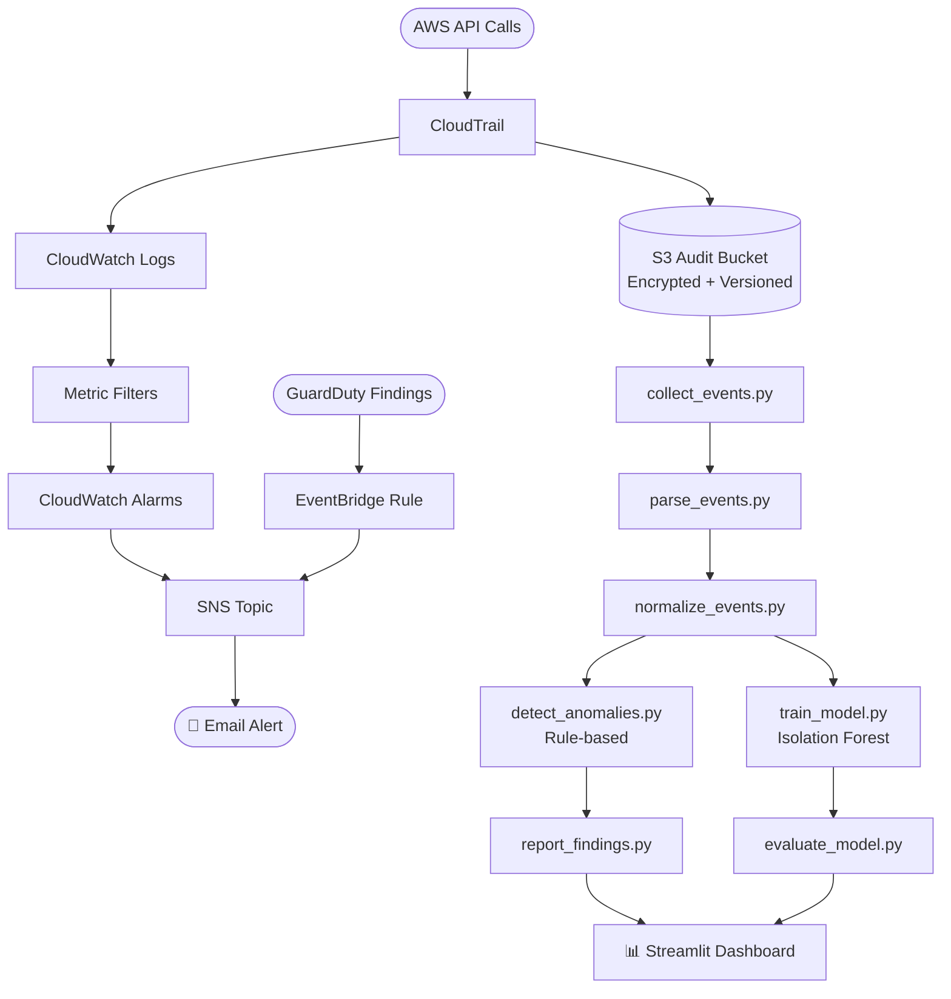

# AWS Suspicious Activity Detector

A complete, beginner-friendly AWS security monitoring project that detects,
analyzes, and alerts on suspicious AWS account activity using CloudTrail,
CloudWatch, GuardDuty, EventBridge, SNS, Python, and optional ML-based
anomaly detection.

---

## Problem Statement

AWS accounts generate thousands of API calls every day. Most are routine.
A small number — root account logins, IAM policy changes, security group
modifications, CloudTrail being disabled — are potentially dangerous and
require immediate investigation.

Without automated monitoring, these events can go unnoticed for hours or days,
giving attackers time to escalate privileges, exfiltrate data, or destroy
infrastructure.

---

## Objectives

- Record all AWS management events with CloudTrail
- Stream events to CloudWatch Logs and trigger metric-based alarms
- Enable GuardDuty for ML-based threat detection
- Route GuardDuty findings to email via EventBridge and SNS
- Build a Python data pipeline to process, normalise, and analyse events
- Add optional Isolation Forest anomaly detection
- Visualise results in a local Streamlit dashboard

---

## Architecture



---

## AWS Services and Their Roles

| Service | Role |
|---------|------|
| **CloudTrail** | Records every AWS management API call with who, what, when, from where |
| **S3** | Stores encrypted CloudTrail log files for long-term audit retention |
| **CloudWatch Logs** | Receives a real-time stream of CloudTrail events |
| **CloudWatch Metrics/Alarms** | Filters log streams and triggers alarms on suspicious patterns |
| **SNS** | Delivers email notifications when alarms fire |
| **GuardDuty** | Applies ML models to detect threats like credential compromise, recon, and exfiltration |
| **EventBridge** | Routes GuardDuty findings to SNS based on severity rules |
| **IAM** | Controls least-privilege access for every component |
| **STS** | Provides caller identity for verification and attribution |

---

## Project Structure

```
aws-suspicious-activity-detector/
├── README.md
├── requirements.txt
├── .gitignore
├── .env.example
├── config/
│   └── config.example.json
├── scripts/
│   ├── verify_aws_setup.py       ← Phase 1: environment check
│   ├── generate_sample_activity.py ← Phase 3: safe API test calls
│   └── cleanup_resources.py      ← Phase 12: resource cleanup
├── src/
│   ├── collect_events.py         ← Phase 7: read CloudTrail events
│   ├── parse_events.py           ← Phase 7: parse raw JSON
│   ├── normalize_events.py       ← Phase 7: add severity & flags
│   ├── detect_anomalies.py       ← Phase 7/8: rule-based detection
│   └── report_findings.py        ← Phase 7: generate CSV/JSON report
├── ml/
│   ├── train_model.py            ← Phase 8: Isolation Forest training
│   └── evaluate_model.py         ← Phase 8: scoring & comparison
├── dashboard/
│   └── app.py                    ← Phase 9: Streamlit dashboard
├── tests/
│   ├── test_parser.py
│   ├── test_normalizer.py
│   └── test_anomaly_detection.py
├── sample_data/
│   └── sample_cloudtrail_events.json  ← Synthetic events (no real data)
└── docs/
    ├── architecture.md
    ├── setup_guide.md
    ├── testing_guide.md
    └── troubleshooting.md
```

---

## Prerequisites

- AWS account (Free Tier suitable for most phases)
- Python 3.9+ with pip
- AWS CLI v2
- Git

---

## Quick Start (Phase 1 — No AWS Resources Created)

```bash
# 1. Create and activate a virtual environment
python -m venv .venv
.venv\Scripts\activate.bat          # Windows CMD
# source .venv/bin/activate         # macOS/Linux

# 2. Install dependencies
pip install -r requirements.txt

# 3. Copy and configure environment file
copy .env.example .env

# 4. Run environment checks (local only)
python scripts/verify_aws_setup.py --skip-aws

# 5. Run unit tests against synthetic data
pytest tests/ -v

# 6. Run the full local pipeline
python src/report_findings.py

# 7. Launch the dashboard (synthetic data)
streamlit run dashboard/app.py
```

---

## Phase Progress

| Phase | Description | Status |
|-------|-------------|--------|
| 1 | Environment setup, project scaffold, local tests | ✅ Complete |
| 2 | CloudTrail trail and S3 logging | ⏳ Pending review |
| 3 | Generate sample API activity | ⏳ Pending review |
| 4 | CloudWatch metric filters and alarms | ⏳ Pending review |
| 5 | GuardDuty enable and findings | ⏳ Pending review |
| 6 | EventBridge routing to SNS | ⏳ Pending review |
| 7 | Python data engineering pipeline | ✅ Scaffold complete |
| 8 | ML anomaly detection (Isolation Forest) | ✅ Scaffold complete |
| 9 | Streamlit security dashboard | ✅ Scaffold complete |
| 10 | Project structure | ✅ Complete |
| 11 | Testing and validation | ✅ Local tests complete |
| 12 | Documentation and cleanup | ✅ In progress |

---

## Security Considerations

- All credentials are stored in `.env` (git-ignored — never committed)
- CloudTrail logs are encrypted at rest in S3
- Log file validation is enabled (detects tampering)
- IAM permissions follow least-privilege for each phase
- No real malicious activity is generated for testing
- The dashboard is local-only and never exposes secrets
- An anomaly score or rule finding is **not** a confirmed incident —
  always investigate manually before taking action
- Never automatically block users based solely on an ML prediction

---

## Estimated AWS Cost Categories

> **Phase 1 costs nothing.** Costs apply from Phase 2 onwards.

| Service | Free Tier | Typical Cost |
|---------|-----------|-------------|
| CloudTrail | 1 trail free | $2/100k events beyond free tier |
| S3 (logs) | 5 GB free | ~$0.023/GB/month |
| CloudWatch Logs | 5 GB ingestion free | $0.50/GB beyond |
| CloudWatch Alarms | 10 alarms free | $0.10/alarm/month |
| SNS | 1M notifications free | Near-zero for email |
| GuardDuty | 30-day free trial | ~$4/million events after trial |
| EventBridge | 1M events free | Near-zero |

Estimated monthly cost for a low-traffic sandbox: **$0–$5/month**.

---

## Cleanup

```bash
# Dry run — see what would be deleted
python scripts/cleanup_resources.py --dry-run

# Interactive cleanup (confirms each resource group)
python scripts/cleanup_resources.py
```

---

## Future Enhancements

- [ ] Multi-region CloudTrail trail
- [ ] Slack/Teams notification channel via SNS
- [ ] AWS Security Hub integration
- [ ] Athena queries on S3 CloudTrail logs
- [ ] SIEM export (Splunk, Datadog)
- [ ] Labelled evaluation dataset for supervised ML
- [ ] Container deployment (Docker + ECS/Lambda)
- [ ] Automated remediation workflows with Lambda (with human approval gate)

---

## Disciplines Demonstrated

| Discipline | How |
|-----------|-----|
| **Cloud Engineering** | AWS architecture, IAM design, service integration |
| **Security Engineering** | Threat detection rules, audit logging, least-privilege IAM |
| **Data Engineering** | Event collection, JSON parsing, normalisation, CSV/JSON output |
| **AI Engineering** | Isolation Forest anomaly detection, feature engineering, model evaluation |

---

## Author Notes

This project was built as a complete, hands-on learning exercise covering
AWS security fundamentals, Python data pipelines, and practical ML application
in a security context.
