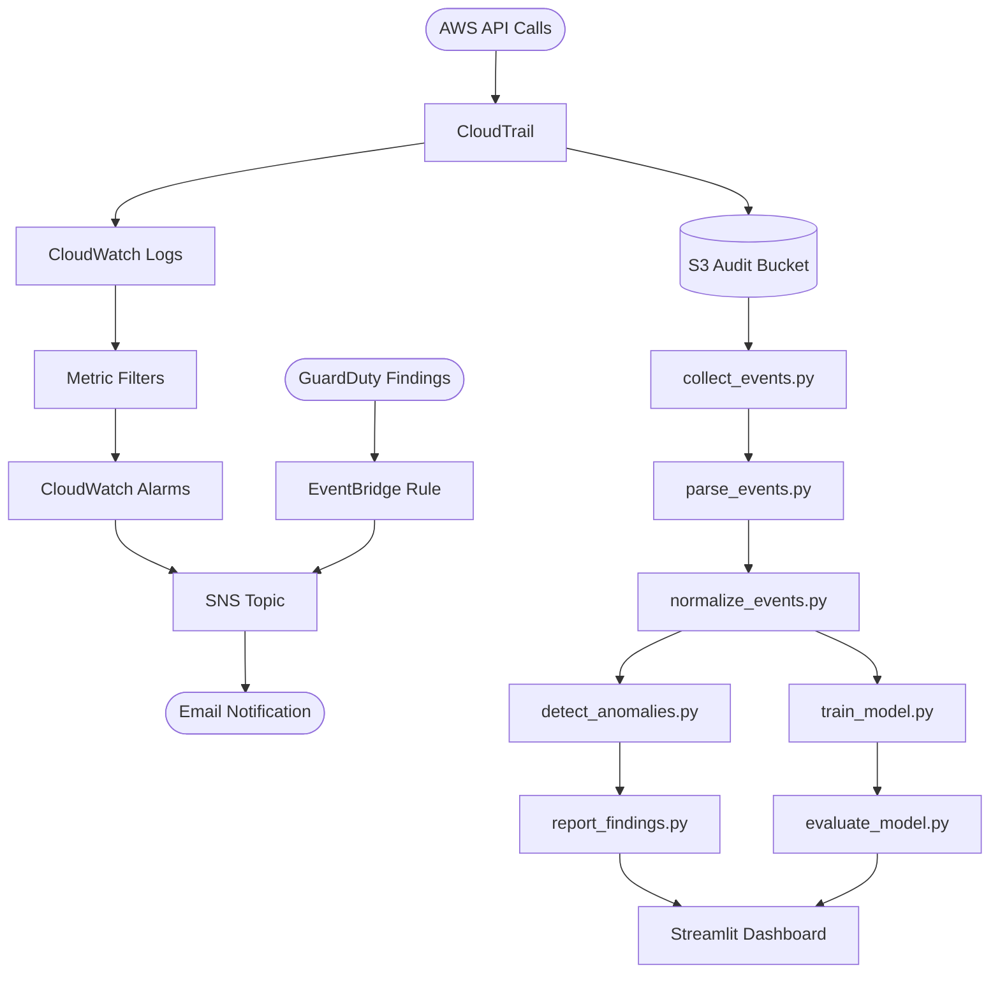

# Architecture

## High-Level Data Flow

## Component Responsibilities

| Component | Service / File | Purpose |
|-----------|---------------|---------|
| Event capture | AWS CloudTrail | Records all management API calls |
| Log storage | Amazon S3 | Long-term encrypted audit log store |
| Real-time delivery | CloudWatch Logs | Streams events for metric filtering |
| Alerting | CloudWatch Alarms + SNS | Notifies on threshold breaches |
| Threat detection | Amazon GuardDuty | ML-based finding generation |
| Event routing | Amazon EventBridge | Routes GuardDuty findings to SNS |
| Data collection | collect_events.py | Reads CloudTrail API or local file |
| Parsing | parse_events.py | Extracts structured fields from raw JSON |
| Normalisation | normalize_events.py | Adds severity, flags, derived fields |
| Detection | detect_anomalies.py | Rule-based + optional ML anomaly detection |
| Reporting | report_findings.py | Generates CSV and JSON reports |
| ML training | train_model.py | Trains Isolation Forest |
| ML evaluation | evaluate_model.py | Scores events, compares with rules |
| Dashboard | app.py (Streamlit) | Local visualisation of results |

## IAM Permission Scopes

Each script requires the minimum permissions for its function:

- `verify_aws_setup.py` — `sts:GetCallerIdentity` only
- `generate_sample_activity.py` — read-only: `ec2:Describe*`, `s3:ListBuckets`,
  `iam:ListUsers`, `iam:GetAccountPasswordPolicy`, `cloudtrail:DescribeTrails`,
  `guardduty:ListDetectors`
- Pipeline scripts — `cloudtrail:LookupEvents`, `s3:GetObject` (trail bucket only)
- CloudWatch setup — `logs:*`, `cloudwatch:*`, `sns:*`
- GuardDuty setup — `guardduty:*`
- EventBridge setup — `events:*`

See `docs/setup_guide.md` for exact IAM policy JSON for each phase.
